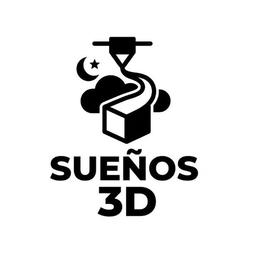

# 🌙 Sueños 3D — Calculadora de Precios de Impresión 3D (CLP 🇨🇱)

<p align="center">
  
</p>

Aplicación de escritorio multiplataforma (**Linux, Windows y macOS**) construida con **React + Vite + Electron** para calcular y cotizar impresiones 3D en **Pesos Chilenos (`$ CLP`)**.

---

## ✨ Características Principales

- **Cálculo en Pesos Chilenos (`es-CL`) en tiempo real**:
  - **Modo Básico (Costo Directo)**: Solo gramos de filamento + horas de electricidad.
  - **Modo Comercial Completo**: Incluye **Margen de Ganancia (%)**, **Tasa de Fallos / Merma (%)**, interruptor de **IVA (19% Chile)** y redondeo configurable (`$10`, `$100`, `$500`).
- **Catálogo Guardado de Filamentos**:
  - Registro por **Marca**, **Material** (`PLA`, `PLA+`, `Hyper PLA`, `PLA Silk`, `PETG`, `ABS`, `ASA`, `TPU`, `Nylon/CF`, `Resina UV`), **Color** (con selector visual), **Peso del rollo (g)** y **Precio en CLP**.
- **Catálogo de Impresoras 3D + Valor Hora Luz Automático**:
  - Incluye perfiles preconfigurados para **Bambu Lab X2D** (modo PLA/PETG y modo Cámara Activa ABS/ASA/PC), **Bambu Lab H2D / X1C / P1S / A1 / A1 Mini**, **Creality**, **Prusa**, **Anycubic** y **Elegoo**.
  - Calcula automáticamente el **Valor Hora Luz en CLP** según el consumo en Watts de la máquina y la tarifa eléctrica chilena (`Enel`, `CGE`, `Chilquinta`, `Saesa` o valor personalizado por kWh).
- **Historial de Cotizaciones, WhatsApp y Exportación a PDF**:
  - Guardado automático en disco local (`printcost-cl-database.json`) y `localStorage`.
  - Copia de resumen con formato listo para **WhatsApp** y exportación directa de hoja de cotización en **PDF** con logo de **Sueños 3D**.
  - Respaldo e importación de base de datos en formato `.json`.

---

## 🚀 Desarrollo y Uso Local

### 1. Instalar dependencias
```bash
npm install
```

### 2. Abrir como Aplicación de Escritorio (Electron)
```bash
npm start
```

### 3. Ejecutar en navegador (Modo Web / Vite)
```bash
npm run dev
```

---

## 📦 Generar Instaladores (Linux, Windows y macOS)

- **Linux (`.AppImage`, `.deb`, `.rpm`)**:
  ```bash
  npm run dist:linux
  ```
- **Windows (`Setup.exe` y `.zip`)**:
  ```bash
  npm run dist:win
  ```
- **macOS (`Apple Silicon arm64` e `Intel x64`)**:
  ```bash
  npm run dist:mac
  ```
